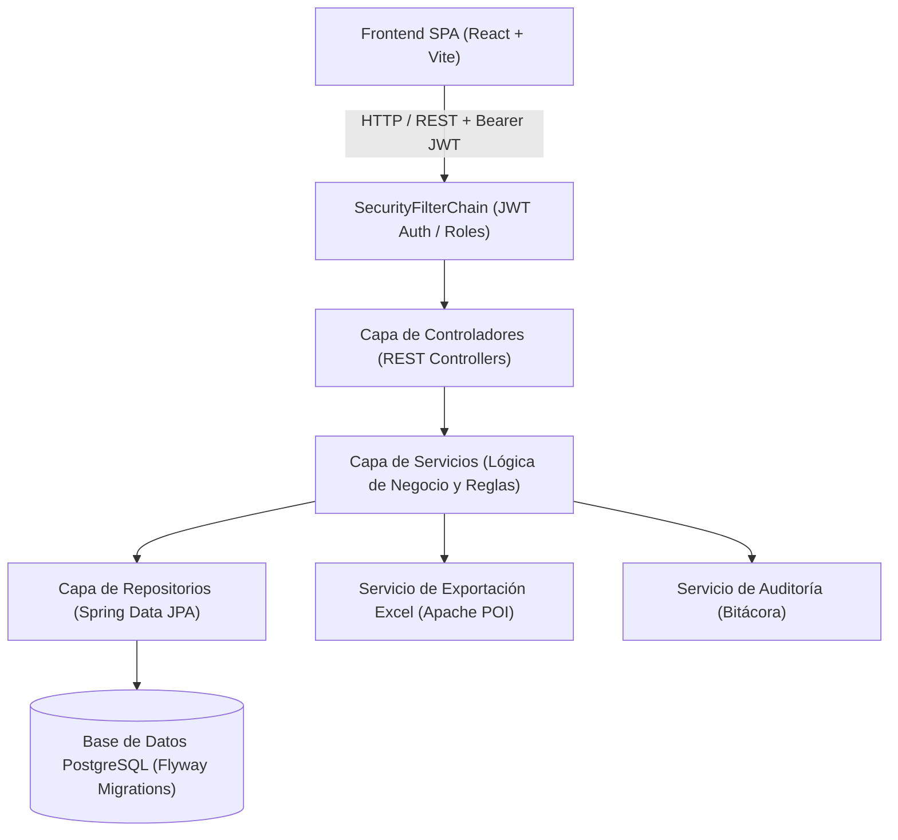

# Sistema CDA - Carga Docente y Asignación Académica
## Universidad del Valle - Sede Palmira

---

## 1. Visión General del Proyecto

El sistema **CDA (Carga Docente y Asignación Académica)** es una plataforma web integral diseñada para la **Universidad del Valle - Sede Palmira**, cuyo propósito es centralizar, optimizar y automatizar los procesos de:
- Autenticación institucional vía **Google OAuth2** y autorización mediante **JWT**.
- Registro y gestión de la **disponibilidad horaria** de los docentes en bloques de 30 minutos.
- Solicitudes y aprobaciones de **acceso extraordinario** fuera del calendario regular.
- Generación automatizada de la **programación académica** por período a partir de las mallas curriculares (pensum) y cohortes activas.
- Asignación docente inteligente con validación de:
  - Disponibilidad semanal registrada.
  - Distribución de sesiones: **1 día continuo** o **dividido en 2 días** (`dia2`, `horaInicio2`, `horaFin2`).
  - Límite de carga máxima por docente (20 horas semanales).
  - Detección de colisiones o cruces de horarios entre asignaturas.
  - Histórico de evaluación docente y ranking de idoneidad.
- Auditoría continua de operaciones administrativas a través de una **bitácora** detallada.
- Generación de reportes y exportación en formato **Excel** con métricas de avance de programación.

---

## 2. Arquitectura del Sistema

El backend está desarrollado sobre **Java 17** y **Spring Boot 3.x**, estructurado bajo una arquitectura multicapa desacoplada:



### Principales Tecnologías Backend:
- **Lenguaje**: Java 17 (Eclipse Temurin / OpenJDK).
- **Framework**: Spring Boot 3.3.x.
- **Seguridad**: Spring Security 6 con autenticación JWT sin estado (stateless) y verificación de tokens de Google (`google-api-client`).
- **Persistencia**: Spring Data JPA / Hibernate sobre PostgreSQL.
- **Control de Versiones de BD**: Flyway (migraciones versionadas `V1` a `V38`).
- **Documentación de API**: Springdoc OpenAPI / Swagger UI (`/swagger-ui.html`).
- **Reportes**: Apache POI (generación de hojas de cálculo `.xlsx`).
- **Gestor de Compilación**: Gradle 8.x / 9.x.

---

## 3. Catálogo y Mapa de Paquetes (`cda-backend`)

```text
co.edu.univalle.palmira
├── config/             # Configuración de Seguridad, JWT, OpenAPI, Propiedades
├── constant/           # Constantes globales del sistema y seguridad
├── controller/         # Endpoints REST (Controladores HTTP)
├── dto/                # Objetos de Transferencia de Datos (Request/Response Records/Classes)
├── exception/          # Manejo centralizado de excepciones y errores HTTP
├── model/
│   ├── entity/         # Entidades JPA mapeadas a tablas de PostgreSQL
│   └── enums/          # Enumeraciones de dominio (Jornadas, Estados, Roles, etc.)
├── repository/         # Interfaces de persistencia JPA y especificaciones
└── service/            # Lógica de negocio, reglas de dominio y validaciones
```

---

## 4. Descripción Detallada de Módulos y Archivos

### 4.1. Capa de Configuración (`config` & `constant`)
- `SecurityConfig.java`: Configuración del filtro de seguridad `SecurityFilterChain`, validación de tokens JWT mediante `NimbusJwtDecoder`, CORS para el frontend y control de accesos basado en roles (`ADMIN`, `COORDINADOR`, `DOCENTE`).
- `OpenApiConfig.java`: Especificación OpenAPI 3 para la documentación interactiva Swagger.
- `CuposProperties.java`: Propiedades tipadas (`app.cupos.*`) para máximos de estudiantes por curso y límites de edición.
- `CargaProperties.java`: Parámetros de carga máxima docente semanal (tope estándar de 20 horas).
- `AsociacionesHistoricoInitializer.java`: Inicializador de precarga de históricos al arrancar la aplicación.
- `AuthConstants.java`: Constantes de nombres de roles, mensajes de autenticación y encabezados.

### 4.2. Capa de Controladores (`controller`)
Expone la API REST consumida por el frontend `mi-app`:

| Controlador | Ruta Base | Descripción |
|---|---|---|
| `AuthController` | `/api/auth` | Login institucional con Google OAuth2 e intercambio de tokens JWT. |
| `ProgramacionController` | `/api/programacion` | Generación automática de programación, consulta con filtros, exclusión/reactivación de cursos, gestión de cupos y asignación horaria de docentes (1 y 2 días). |
| `DocenteController` | `/api/docentes` | CRUD de docentes, asociación con programas y consulta de perfil. |
| `DisponibilidadDocenteController` | `/api/docentes/disponibilidad` | Registro, modificación y consulta de las franjas horarias semanales de los docentes. |
| `AdminDisponibilidadDocenteController` | `/api/admin/disponibilidad` | Vista y gestión administrativa de la disponibilidad de todos los docentes de la facultad. |
| `AccesoExtraordinarioController` | `/api/acceso-extraordinario` | Solicitudes de docentes para habilitar modificación extemporánea de disponibilidad y aprobación administrativa. |
| `CargaDocenteController` | `/api/carga-docente` | Métricas de horas asignadas vs. disponibles por docente y porcentaje de carga. |
| `AvanceProgramacionController` | `/api/avance-programacion` | Reportes de avance y descarga de archivo Excel consolidado. |
| `DocenteAsignaturaController` | `/api/docente-asignatura` | Histórico y ranking de evaluaciones docentes por materia. |
| `ElectivaProgramadaController` | `/api/electivas` | Gestión de asignaturas electivas y cupos asignados. |
| `CohorteController` | `/api/cohortes` | Cohortes académicas matriculadas por período. |
| `PeriodoAcademicoController` | `/api/periodos` | Períodos lectivos (semestres) y sus fechas de vigencia. |
| `ProgramaController` | `/api/programas` | Programas académicos de la sede Palmira. |
| `CoordinadorController` | `/api/coordinadores` | Asignación y gestión de directores/coordinadores de programa. |
| `FacultadController` | `/api/facultades` | Facultades y dependencias académicas. |
| `AsignaturaController` | `/api/asignaturas` | Catálogo maestro de asignaturas con sus créditos y horas semanales. |
| `PensumController` | `/api/pensum` | Malla curricular por programa y resolución. |
| `MisCursosController` | `/api/mis-cursos` | Cursos asignados al docente autenticado. |
| `BitacoraController` | `/api/bitacora` | Consulta y filtrado de la auditoría de acciones del sistema. |
| `CatalogoController` | `/api/catalogo` | Listas desplegables y parámetros de dominio. |

### 4.3. Capa de Servicios (`service`)
Contiene las reglas de negocio y transacciones:

- `ProgramacionService`:
  - Algoritmo de generación de cursos a partir de cohortes confirmadas y la malla curricular (`pensum`).
  - Asignación de docentes con validación de:
    - Pertenencia a la franja de disponibilidad registrada del docente.
    - Soporte de distribución en **1 día** (`dia`, `horaInicio`, `horaFin`) o **2 días** (`dia2`, `horaInicio2`, `horaFin2`).
    - Validación de colisión de horarios entre cursos del mismo docente (`validarCruceHorario`).
    - Control de carga máxima semanal ($\le 20$ horas).
    - Exclusión y reactivación de cursos manteniendo la numeración secuencial de grupos (desde el grupo 50).
    - Registro de bitácora en cada cambio de estado o asignación.
- `GoogleAuthService`:
  - Valida el token `idToken` contra los servidores de Google (`GoogleIdTokenVerifier`).
  - Valida el dominio institucional (`@correounivalle.edu.co`).
  - Identifica el rol del usuario (`ADMIN`, `COORDINADOR`, `DOCENTE`) y emite el JWT firmado con sus claims (`authorities`, `codeProgram`, `nombre`).
- `DisponibilidadDocenteService`:
  - Administra las franjas horarias semanales (días 1 al 6: Lunes a Sábado; horas `07:00` a `21:00`).
  - Valida solapamientos internos y fechas límites de período regular o prórroga extraordinaria.
- `CargaDocenteService`:
  - Suma horas presenciales de los cursos asignados a cada profesor.
  - Controla que ningún profesor exceda las 20 horas de carga máxima permitida por normativa.
- `AvanceProgramacionExcelService`:
  - Genera archivos `.xlsx` usando Apache POI, estructurando hojas de resumen, avance por programa, materias sin asignar y alertas de cupos.
- `AccesoProgramaService`:
  - Garantiza la seguridad a nivel de datos: un coordinador únicamente puede consultar o modificar cursos de los programas que tiene formalmente asignados.
- `BitacoraService`:
  - Registra de forma asíncrona/transaccional cada acción relevante (creación, edición, exclusión, reactivación) con el usuario, fecha, motivo y datos anteriores/nuevos.

### 4.4. Capa de Entidades (`model/entity`)
Mapeo objeto-relacional con JPA/Hibernate:
- `CursoProgramacion`: Representa la instancia ofertada de una asignatura en un período. Incluye programa, cohorte, grupo, docente asignado, horas, cupos, estado (`PROGRAMADO`, `ASIGNADO`, `EXCLUIDO`), justificación de exclusión, y campos de horario (`dia`, `hora_inicio`, `hora_fin`, `dia2`, `hora_inicio2`, `hora_fin2`, `horario`).
- `Docente`: Información personal, código institucional, correo `@correounivalle.edu.co`, tipo de vinculación (Nombrado, Hora Cátedra, Ocasional) y programa base.
- `DisponibilidadDocente`: Franja semanal declarada por un docente para un período específico (`dia`, `hora_inicio`, `hora_fin`).
- `PeriodoAcademico`: Período semestral (ej. `2026-1`), fechas de inicio/fin de clases y ventanas de registro de disponibilidad.
- `Asignatura`: Código oficial, nombre, créditos, horas teóricas, horas prácticas y horas semanales presenciales.
- `PensumAcademico`: Relación entre un programa académico y las asignaturas que componen su plan de estudios por semestre.
- `CohortePeriodo`: Registra la cantidad de cohortes o grupos previstos para un semestre en un período.
- `EvaluacionDocente`: Calificación histórica de los estudiantes a un docente en una asignatura.
- `AccesoExtraordinario`: Solicitudes y estados de prórroga para registrar disponibilidad horaria.
- `Bitacora`: Registro inmutable de eventos del sistema para trazabilidad y auditoría.

---

## 5. Esquema de Base de Datos y Migraciones Flyway

Las migraciones se encuentran en `src/main/resources/db/migration/`:
- `V1` a `V36`: Creación inicial de tablas maestros, roles, relaciones de pensum, cohortes, bitácora y tablas de evaluación docente.
- `V37__horario_cursos_programacion.sql`: Agrega a `cursos_programacion` las columnas de horario base: `dia`, `hora_inicio`, `hora_fin`, y `horario`.
- `V38__horario_segundo_dia_cursos.sql`: Amplía `cursos_programacion` con soporte para una segunda sesión semanal (`dia2`, `hora_inicio2`, `hora_fin2`) y expande la longitud de `horario` a `VARCHAR(150)` para soportar descripciones compuestas.

---

## 6. Frontend (`mi-app`) y Flujo de Interacción

El frontend desarrollado en **React + Vite** interactúa con esta API:
1. **Login**: Inicia sesión mediante Google Sign-In, recibe el JWT y guarda el rol y claims en el estado global.
2. **Disponibilidad (`DisponibilidadView.jsx`)**: Cuadrícula semanal interactiva con intervalos claros de 30 minutos (`07:00 – 07:30`, etc.), resumen dinámico de horas seleccionadas y guardado automático.
3. **Asignación Docente (`AsignacionDocenteView.jsx`)**:
   - Modal interactivo para coordinadores.
   - Selector de modalidad de horario: **1 Día** o **2 Días**.
   - Filtro reactivo de docentes disponibles que cumplen con la cantidad de horas requeridas y límite $\le 20$ h.
   - Prevención visual y en tiempo real de cruces de horario.
4. **Programación y Cupos (`ProgramacionView.jsx`)**: Vista de cursos por programa y semestre con opciones de exclusión justificada y control de cupos.
5. **Reportes y Auditoría**: Monitoreo de avance y descarga de reporte Excel.

---

## 7. Comandos de Compilación, Ejecución y Pruebas

```bash
# Compilar el backend
./gradlew build -x test

# Ejecutar la suite completa de pruebas unitarias e integración
./gradlew test

# Ejecutar el backend en modo desarrollo
./gradlew bootRun

# Compilar el frontend (en la carpeta ../mi-app)
cd ../mi-app
npm install
npm run build
npm run dev
```
